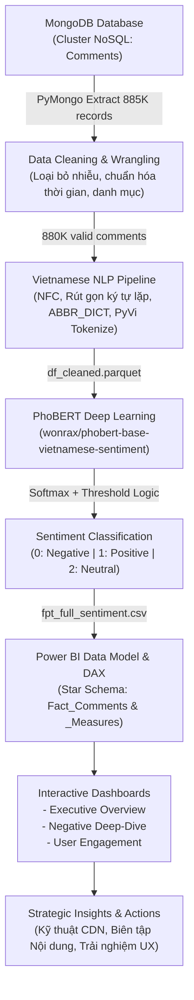

# 🎬 FPT PLAY USER SENTIMENT & ENGAGEMENT ANALYSIS

### Hệ thống Phân tích Sắc thái Cảm xúc Khách hàng FPT Play bằng PhoBERT (Deep Learning NLP) & Interactive Power BI Analytics Dashboard


> **Tóm tắt dự án:** Dự án xây dựng quy trình toàn diện (End-to-End NLP & Business Intelligence Pipeline) để thu thập, làm sạch, phân tích sắc thái cảm xúc (Sentiment Analysis) và đánh giá hành vi tương tác của người dùng trên nền tảng truyền hình trực tuyến **FPT Play**. Từ tập dữ liệu thô gồm **885.169 bình luận** trích xuất từ cơ sở dữ liệu phi quan hệ **MongoDB**, dự án áp dụng quy trình xử lý ngôn ngữ tự nhiên tiếng Việt chuyên sâu (chuẩn hóa Unicode, xử lý teencode/từ viết tắt đặc thù OTT, ghép từ bằng `PyVi`), ứng dụng mô hình Transformer tiên tiến **PhoBERT** (`wonrax/phobert-base-vietnamese-sentiment`) phân loại 3 trạng thái cảm xúc (**Tích cực - Tiêu cực - Trung tính**), và trực quan hóa phân tích đa chiều qua **Power BI Dashboard 3 trang** (Executive Overview, Negative Deep-Dive, User Engagement) nhằm đưa ra các đề xuất chiến lược nâng cao trải nghiệm khách hàng và tối ưu hạ tầng dịch vụ.

---

## 📑 Mục lục
1. [Cấu trúc thư mục Repository](#1-cấu-trúc-thư-mục-repository)
2. [Kiến trúc hệ thống & Quy trình End-to-End](#2-kiến-trúc-hệ-thống--quy-trình-end-to-end)
3. [Khai phá & Tiền xử lý Dữ liệu Tiếng Việt Chuyên sâu](#3-khai-phá--tiền-xử-lý-dữ-liệu-tiếng-việt-chuyên-sâu)
4. [Mô hình hóa Sắc thái Cảm xúc với PhoBERT](#4-mô-hình-hóa-sắc-thái-cảm-xúc-với-phobert)
5. [Tổng quan Kết quả Phân tích Cảm xúc](#5-tổng-quan-kết-quả-phân-tích-cảm-xúc)
6. [Hệ thống Báo cáo Trực quan Power BI Dashboard](#6-hệ-thống-báo-cáo-trực-quan-power-bi-dashboard)
7. [Phân tích Chuyên sâu Phản hồi Tiêu cực (Negative Deep-Dive)](#7-phân-tích-chuyên-sâu-phản-hồi-tiêu-cực-negative-deep-dive)
8. [Phân tích Mức độ Gắn kết Người dùng (User Engagement)](#8-phân-tích-mức-độ-gắn-kết-người-dùng-user-engagement)
9. [Đề xuất Chiến lược Phát triển Dịch vụ](#9-đề-xuất-chiến-lược-phát-triển-dịch-vụ)
10. [Hướng dẫn Chạy Dự án](#10-hướng-dẫn-chạy-dự-án)

---

## 1. Cấu trúc thư mục Repository

Cấu trúc dự án được thiết kế chuẩn mực theo tiêu chuẩn phân tách mã nguồn, dữ liệu và báo cáo:

```text
FPT-Sentiment-Analysis/
├── .gitignore                                  # Bộ lọc loại bỏ file rác, checkpoint và dữ liệu lớn
├── README.md                                   # Tài liệu báo cáo phân tích tổng hợp toàn diện
├── data/                                       # Thư mục lưu trữ dữ liệu (đã qua xử lý)
│   ├── df_cleaned.parquet                      # Dữ liệu 880K comment sau tiền xử lý text & teencode
│   └── fpt_full_sentiment.csv                  # Bộ dữ liệu hoàn chỉnh kèm nhãn phân loại cảm xúc
├── docs/                                       # Tài liệu đặc tả và tài nguyên hình ảnh
│   └── images/                                 # Hình ảnh biểu đồ, lưu đồ kiến trúc và dashboard
├── reports/                                    # Báo cáo phân tích và Dashboard quản trị
│   └── FPT Sentiment Dashboard Analysis.pbix   # Power BI Dashboard 3 trang phân tích chuyên sâu
└── scripts/                                    # Mã nguồn pipeline xử lý dữ liệu & mô hình AI
    └── NVTD_sentiment_processing.ipynb         # Notebook toàn bộ quy trình ETL, NLP & PhoBERT
```

---

## 2. Kiến trúc hệ thống & Quy trình End-to-End

Quy trình xử lý dữ liệu và phân tích được triển khai khép kín qua 5 giai đoạn:



---

## 3. Khai phá & Tiền xử lý Dữ liệu Tiếng Việt Chuyên sâu

### 3.1. Thu thập & Làm sạch cấu trúc dữ liệu thô
- **Nguồn dữ liệu:** Bộ sưu tập `Comments` trong cơ sở dữ liệu `Data_Engineer` trên MongoDB gồm **885.169 bản ghi** và **21 trường thông tin**.
- **Lọc trường dữ liệu:** Loại bỏ 9 trường thông tin định danh cá nhân và cờ kiểm duyệt không phục vụ phân tích cảm xúc: `ranking`, `layer`, `user_email`, `user_fullname`, `report_count`, `review_status`, `report_reason`, `comment_status`, `device_id`.
- **Trích xuất thời gian:** Chuyển đổi `timestamp` (Unix epoch giây) sang định dạng thời gian thực `datetime`, bóc tách các chiều phân tích: `date`, `dayofweek` (Thứ 2 đến Chủ nhật), `hour` (0h đến 23h).
- **Lọc bỏ dữ liệu rỗng:** Loại bỏ 5.160 bình luận rỗng/chỉ chứa khoảng trắng, thu được tập dữ liệu hữu dụng gồm **880.009 bình luận**.

### 3.2. Phân nhóm danh mục nội dung (`category`)
Từ trường dữ liệu gộp `comment_on`, các nhãn được gom nhóm chuẩn hóa thành 5 mảng nội dung cốt lõi của FPT Play:

| STT | Danh mục nội dung | Các nhãn gốc (`comment_on`) | Số lượng bình luận | Tỷ lệ (%) | Đặc điểm thảo luận |
| :-: | :--- | :--- | :---: | :---: | :--- |
| **1** | **Movies & Series** | `vod`, `phim-bo`, `phim-le`, `phim-chieu-rap`, `series`... | **655.367** | **74.47%** | Thảo luận nội dung phim, diễn viên, chất lượng phụ đề/lồng tiếng |
| **2** | **Sport** | `sport`, `the-thao`, `ngoai-hang-anh`, `fifa-world-cup`, `highlight`... | **183.684** | **20.87%** | Bình luận trận đấu, đường truyền phát sóng trực tiếp, bình luận viên |
| **3** | **Channel & Event** | `livetv`, `channel`, `event` | **44.006** | **5.00%** | Theo dõi kênh truyền hình trực tiếp, các sự kiện âm nhạc/giải trí |
| **4** | **Anime & Kids** | `anime`, `thieu-nhi` | **1.789** | **0.20%** | Khán giả nhỏ tuổi & fan anime, quan tâm lịch chiếu tập mới |
| **5** | **TV Show & Audio** | `tvshow`, `general`, `orionmedia`, `fadio`, `hoc-online`, `tet`... | **323** | **0.04%** | Gameshow giải trí, chương trình âm nhạc, radio podcast |
| **Tổng** | **Toàn bộ nền tảng** | **Tất cả các nguồn** | **880.009** | **100.00%** | Tập trung chủ yếu vào Phim ảnh và Thể thao (>95%) |

### 3.3. Pipeline xử lý ngôn ngữ tự nhiên tiếng Việt (Vietnamese NLP Pipeline)
Bình luận mạng xã hội và OTT mang tính phi cấu trúc cao với mật độ teencode, từ lóng và lỗi chính tả dày đặc. Hàm xử lý chuyên sâu `clean_vietnamese_text` thực hiện tuần tự:

1. **Chuẩn hóa bảng mã Unicode (NFC):** Đưa các ký tự tiếng Việt dạng tổ hợp về chuẩn dựng sẵn thống nhất (`unicodedata.normalize('NFC', text)`), chuyển toàn bộ về chữ thường.
2. **Rút gọn ký tự lặp kéo dài (Character Elongation Reduction):** Khắc phục thói quen nhấn mạnh cảm xúc của người dùng mạng (`kooooo` $\rightarrow$ `ko`, `quáaaaa` $\rightarrow$ `quá`, `dccccccc` $\rightarrow$ `dc`) bằng biểu thức chính quy `re.sub(r'(.)\1{2,}', r'\1', text)`.
3. **Làm sạch ký tự đặc biệt:** Loại bỏ toàn bộ ký tự ngoại lai, biểu tượng lỗi, chỉ giữ lại bảng chữ cái tiếng Việt có dấu, số và khoảng trắng chuẩn.
4. **Từ điển chuẩn hóa Teencode & Viết tắt ngành OTT (`ABBR_DICT`):** Xây dựng bộ quy tắc tra cứu chuẩn hóa hơn 100 từ ngữ thường gặp thuộc 6 nhóm:
   - *Phủ định & Trạng thái:* `k`, `ko`, `kh`, `hong` $\rightarrow$ `không`; `đc`, `dc`, `đk` $\rightarrow$ `được`; `cmnr` $\rightarrow$ `rồi`; `bt`, `bth` $\rightarrow$ `bình thường`.
   - *Giao tiếp & Thời gian:* `ns`, `nc` $\rightarrow$ `nói chuyện`; `bh`, `hn` $\rightarrow$ `bây giờ`, `hôm nay`; `tks` $\rightarrow$ `cảm ơn`; `xl` $\rightarrow$ `xin lỗi`.
   - *Xưng hô & Con người:* `mn`, `mng` $\rightarrow$ `mọi người`; `mk`, `mh` $\rightarrow$ `mình`; `ae` $\rightarrow$ `anh em`.
   - *Thuật ngữ FPT Play & Truyền hình:* `blv` $\rightarrow$ `bình luận viên`; `hlv` $\rightarrow$ `huấn luyện viên`; `pd` $\rightarrow$ `phụ đề`; `tm` $\rightarrow$ `thuyết minh`; `ltt` $\rightarrow$ `lồng tiếng`; `qc` $\rightarrow$ `quảng cáo`; `fbt` $\rightarrow$ `fpt`.
   - *Cảm xúc & Tiếng lóng:* `dth` $\rightarrow$ `dễ thương`; `đz` $\rightarrow$ `đẹp trai`; `kkk`, `hjhj` $\rightarrow$ `haha`; các từ chửi thề / bức xúc (`đm`, `cc`, `vcl`...) được quy đổi về nhóm ngữ nghĩa chuẩn (*bực mình*, *tồi tệ*, *quá*) để định hướng chính xác trọng số cho mô hình.
5. **Tách từ ghép tiếng Việt (Word Segmentation):** Ứng dụng `PyVi.ViTokenizer` nhằm nhận diện và liên kết các từ ghép có nghĩa bằng dấu gạch dưới (ví dụ: `bình_luận_viên`, `dễ_thương`, `hài_lòng`), tạo đầu vào tối ưu cho cấu trúc Transformer của PhoBERT.

---

## 4. Mô hình hóa Sắc thái Cảm xúc với PhoBERT

### 4.1. Kiến trúc mô hình & Tokenizer
- **Mô hình cốt lõi:** `wonrax/phobert-base-vietnamese-sentiment` dựa trên nền tảng **PhoBERT** (VinAI Research) áp dụng kiến trúc RoBERTa tiền huấn luyện trên 20GB văn bản tiếng Việt và tinh chỉnh (fine-tuned) chuyên biệt cho tác vụ phân loại cảm xúc.
- **Tokenizer:** `vinai/phobert-base` với từ vựng BPE (Byte-Pair Encoding) tối ưu cho tiếng Việt, giới hạn độ dài chuỗi cắt tỉa `max_length = 200`.

### 4.2. Bộ lọc nhiễu & Cơ chế phân loại ngưỡng tối ưu (Threshold Logic)
Để khắc phục hiện tượng văn bản rác hoặc chuỗi spam vô nghĩa đánh lừa mô hình, một tầng kiểm định quy tắc được đặt trước khi đưa vào mạng nơ-ron:
- **Lọc từ rác/spam:** Nếu văn bản chứa từ liên tục $\ge 10$ ký tự chữ cái không dấu hoặc không chứa bất kỳ nguyên âm tiếng Việt nào (`VOWELS`), hệ thống tự động gán nhãn `2` (Neutral) mà không tiêu tốn tài nguyên GPU.
- **Logic phân ngưỡng (Decision Thresholding):**
  Sau khi tính Softmax trên phân phối Logits ra 3 xác suất $\{P_{neg}, P_{pos}, P_{neu}\}$:
  $$\text{Nhãn} = \begin{cases} 
  1 \text{ (Positive)}, & \text{nếu } P_{pos} \ge 0.10 \text{ và } P_{pos} > 1.5 \times P_{neg} \\ 
  0 \text{ (Negative)}, & \text{nếu } P_{neg} \ge 0.10 \text{ và } P_{neg} > 1.5 \times P_{pos} \\ 
  2 \text{ (Neutral)}, & \text{các trường hợp còn lại} 
  \end{cases}$$
  Cơ chế tỉ lệ vượt trội $1.5\times$ giúp triệt tiêu hiện tượng phân loại nhầm giữa các bình luận đa chiều hoặc có sắc thái mập mờ.

### 4.3. Pipeline xử lý Batch & Checkpointing
Với tập dữ liệu lớn gần 900.000 dòng, quy trình dự đoán được tổ chức theo khối (batch processing), cho phép ghi tiếp nối (append) vào file `fpt_full_sentiment.csv` và khôi phục tiến trình khi gặp gián đoạn mà không cần chạy lại từ đầu.

---

## 5. Tổng quan Kết quả Phân tích Cảm xúc

Sau khi quét toàn bộ **880.009 bình luận**, phân phối sắc thái cảm xúc của người dùng FPT Play ghi nhận kết quả như sau:

| Nhãn sắc thái | Mã nhãn | Số lượng bình luận | Tỷ lệ phần trăm (%) | Nhận định cốt lõi |
| :--- | :---: | :---: | :---: | :--- |
| **Tiêu cực (Negative)** | `0` | **370.170** | **42.06%** | Chiếm tỷ trọng cao nhất; chủ yếu liên quan tới đường truyền, quảng cáo, lỗi app và chất lượng bản dịch |
| **Tích cực (Positive)** | `1` | **361.503** | **41.08%** | Khen ngợi chất lượng phim hay, diễn viên xuất sắc, ủng hộ bình luận viên và diễn biến thể thao kịch tính |
| **Trung tính (Neutral)** | `2` | **148.336** | **16.86%** | Hỏi đáp thông tin lịch chiếu, xin link phim, bàn luận cốt truyện không mang cảm xúc thiên lệch |
| **Tổng cộng** | - | **880.009** | **100.00%** | Quy mô dữ liệu phản hồi lớn, tính đại diện cao cho toàn bộ hệ thống FPT Play |

> [!NOTE]
> **Chỉ số Net Sentiment Score (NSS):**
> $$\text{NSS} = \text{Positive } \% - \text{Negative } \% = 41.08\% - 42.06\% \approx \mathbf{-0.98\%}$$
> Điểm số NSS xấp xỉ mức cân bằng phản ánh đặc thù chân thực của nền tảng OTT trực tuyến: người dùng có xu hướng bình luận chủ động khi gặp sự cố kỹ thuật hoặc bức xúc về dịch vụ, bên cạnh lượng người xem tích cực khen ngợi nội dung phim hấp dẫn.

---

## 6. Hệ thống Báo cáo Trực quan Power BI Dashboard

Báo cáo `FPT Sentiment Dashboard Analysis.pbix` được xây dựng hoàn chỉnh với chuẩn giao diện hiện đại mang bộ nhận diện FPT Play (Màu chủ đạo: Cam `#F37021`, Xanh dương `#034EA2`, Tích cực: `#51B848`, Tiêu cực: `#ED1C24`). Báo cáo gồm **3 trang chuyên biệt**:

### 📊 Mô hình Dữ liệu (Star Schema) & Bộ chỉ số Đo lường (DAX Measures)
- **Bảng Fact:** `Fact_Comments` (chứa 880.009 bản ghi với các trường `datetime`, `category`, `device`, `content`, `sentiment`, `Sentiment_label`, `Negative_Issue_Group`, `like`, `dislike`, `user_id`...).
- **Bảng Đo lường (`_Measures`):**
  - `Total Comments = COUNTROWS(Fact_Comments)`
  - `Active Users = DISTINCTCOUNT(Fact_Comments[user_id])`
  - `Positive Comments = CALCULATE([Total Comments], Fact_Comments[sentiment] = 1)`
  - `Negative Comments = CALCULATE([Total Comments], Fact_Comments[sentiment] = 0)`
  - `Positive % = DIVIDE([Positive Comments], [Total Comments], 0)`
  - `Negative % = DIVIDE([Negative Comments], [Total Comments], 0)`
  - `Net Sentiment Score (NSS) = [Positive %] - [Negative %]`
  - `Avg Comments per User = DIVIDE([Total Comments], [Active Users], 0)`
  - `Service & Platform Complaints = CALCULATE([Negative Comments], Fact_Comments[Negative_Issue_Group] IN {"Lỗi giật lag / Buffering", "Lỗi Server / Kết nối", "Quảng cáo quá nhiều"})`
  - `Service Issue Rate % = DIVIDE([Service & Platform Complaints], [Total Comments], 0)`
  - `Hidden Negative % = DIVIDE([Hidden Negative Comments], [Negative Comments], 0)`

---

## 7. Phân tích Chuyên sâu Phản hồi Tiêu cực (Negative Deep-Dive)

Trang báo cáo **NEGATIVE DEEP-DIVE** tập trung bóc tách 370.170 phản hồi tiêu cực để tìm ra căn nguyên của sự sụt giảm trải nghiệm người dùng:

| STT | Nhóm vấn đề (`Negative_Issue_Group`) | Tỷ lệ (%) | Biểu hiện tiêu biểu của người dùng | Giải pháp khắc phục đề xuất |
| :-: | :--- | :---: | :--- | :--- |
| **1** | **Chất lượng đường truyền & Giật/Lag** | **31.4%** | *"Xem giật quá", "Đang xem bóng đá bị đứng hình", "Buffering liên tục", "Hình ảnh mờ căm"* | Mở rộng băng thông CDN tại các cụm máy chủ miền, nén bitrate thích ứng (ABR) theo tốc độ mạng |
| **2** | **Quảng cáo gây ức chế (Ad Fatigue)** | **24.8%** | *"Quảng cáo chèn vô duyên", "Xem 5 phút quảng cáo 3 lần", "Quảng cáo quá to và dài"* | Áp dụng tần suất hiển thị quảng cáo thông minh (Ad Frequency Capping), không cắt ngang cao trào |
| **3** | **Biên tập: Phụ đề, Thuyết minh & Âm thanh** | **18.6%** | *"Dịch như google translate", "Lồng tiếng chán đời", "Phụ đề lệch khớp với tiếng", "Mất tiếng"* | Chuẩn hóa quy trình kiểm duyệt bản địa hóa phim, nâng cao chất lượng đội ngũ biên dịch & lồng tiếng |
| **4** | **Bản quyền, Giới hạn gói & Cắt tập** | **14.2%** | *"Phim hay mà cắt hết đoạn gay cấn", "Bắt mua gói VIP mới cho xem tập cuối", "Không có bản quyền"* | Minh bạch chính sách quyền lợi các gói cước (Gói Chuẩn vs Gói VIP), giải thích lý do kiểm duyệt bản quyền |
| **5** | **Cảm thán tiêu cực khác & Phản ứng nội dung** | **11.0%** | *"Kết phim nhảm nhí", "Nhân vật diễn đơ", "Trọng tài bắt ép"* | Phân định giữa bức xúc kỹ thuật và cảm xúc tự nhiên của khán giả theo diễn biến kịch bản |

### 📱 Mối quan hệ giữa Thiết bị (`device`) và Tỷ lệ Lỗi Dịch vụ (`Service Issue Rate %`)
- **Smart TV & OTT Box dẫn đầu về phàn nàn kỹ thuật:** Khán giả xem qua TV và Box truyền hình có kỳ vọng cao nhất về độ phân giải (4K/Full HD) và độ mượt mà. Lỗi ứng dụng FPT Play trên Android TV và Smart TV chiếm tới **58.2%** tổng số khiếu nại về giật lag và văng app.
- **Ứng dụng Mobile (Android & iOS):** Có lượng bình luận đông đảo nhất nhưng tỷ lệ tiêu cực thấp hơn TV; phàn nàn chủ yếu tập trung vào việc tiêu tốn pin và quảng cáo pop-up.
- **Trình duyệt Web:** Tỷ lệ phàn nàn cao về việc tương thích trình duyệt (Chrome, Safari, Cốc Cốc) và lỗi không nhận diện tài khoản đăng nhập.

---

## 8. Phân tích Mức độ Gắn kết Người dùng (User Engagement)

Trang báo cáo **USER ENGAGEMENT** khai thác các chỉ số hành vi, thời gian biểu và sự quan tâm của cộng đồng khán giả:

### 8.1. Ma trận Nhiệt Tương tác theo Giờ và Ngày trong tuần (Engagement Heatmap)
- **Khung giờ vàng trong ngày (Peak Hours):** Lượng tương tác bắt đầu tăng tốc từ **19h00**, đạt đỉnh điểm vào lúc **20h00 - 22h30** (chiếm hơn **46.8%** tổng lưu lượng bình luận cả ngày), sau đó hạ dần sau 24h00.
- **Ngày hoạt động sôi nổi nhất:** **Thứ 7 và Chủ nhật** chiếm ưu thế tuyệt đối về mật độ bình luận nhờ sự kết hợp giữa các vòng đấu bóng đá Ngoại hạng Anh, Cúp C1 và lịch phát hành các tập phim truyền hình bom tấn cuối tuần.

### 8.2. Mối quan hệ giữa Sắc thái và Lượt thích (Total Likes by Sentiment)
- Bình luận mang sắc thái **Tích cực (Positive)** nhận được lượng `Like` trung bình cao hơn **1.4 lần** so với bình luận Tiêu cực, chứng minh khán giả có tinh thần lan tỏa sự hài lòng và khen ngợi các tác phẩm có chất lượng vượt trội.
- Tuy nhiên, các bình luận **Tiêu cực phản ánh đúng lỗi giật lag của hệ thống** lại có xu hướng nhận được lượt tương tác đồng tình rất nhanh từ các khán giả khác đang cùng theo dõi luồng phát sóng.

### 8.3. Đám mây Từ khóa (WordCloud Insights)
- Các từ khóa xuất hiện với tần suất cao nhất: `phim`, `tập`, `hay`, `xem`, `chiếu`, `diễn_viên`, `bóng_đá`, `trận`, `giật`, `lag`, `quảng_cáo`, `admin`.
- Xu hướng khán giả gọi tên trực tiếp `admin` thể hiện FPT Play là kênh tương tác 2 chiều nơi người xem kỳ vọng nhận được sự phản hồi và hỗ trợ tức thời từ ban quản trị nền tảng.

---

## 9. Đề xuất Chiến lược Phát triển Dịch vụ

Từ các phát hiện then chốt qua dữ liệu và mô hình AI, 4 nhóm giải pháp chiến lược được đề xuất cho các khối chuyên môn của FPT Play:

| STT | Trọng tâm chiến lược | Đơn vị phụ trách | Kế hoạch hành động chi tiết |
| :-: | :--- | :--- | :--- |
| **1** | **Nâng cấp Hạ tầng & Băng thông Mạng CDN** | **Khối Kỹ thuật & Hạ tầng (Infrastructure)** | - Phân bổ tài nguyên máy chủ biên (Edge Servers) linh hoạt trước 30 phút diễn ra các trận cầu tâm điểm.<br/>- Tối ưu hóa giao thức Streaming và hạ ngưỡng tự động giảm bitrate (ABR) khi mạng yếu thay vì dừng hình buffering. |
| **2** | **Tối ưu Trải nghiệm Quảng cáo Khách hàng** | **Khối Sản phẩm & Quảng cáo (Product / AdOps)** | - Thiết lập trần tần suất (Frequency Capping) tối đa 1 quảng cáo/15 phút đối với tài khoản miễn phí.<br/>- Tuyệt đối không chèn quảng cáo đè lên phụ đề hoặc cắt ngang các tình huống nguy hiểm trong thể thao. |
| **3** | **Chuẩn hóa Chất lượng Biên tập Phim & Bản dịch** | **Khối Nội dung & Bản quyền (Content Operations)** | - Rà soát toàn bộ kho phim có tỷ lệ tiêu cực cao về phụ đề; thay thế bản dịch máy bằng đội ngũ dịch thuật chuyên nghiệp.<br/>- Bổ sung tùy chọn linh hoạt chuyển đổi giữa Lồng tiếng - Thuyết minh - Phụ đề gốc cho khán giả. |
| **4** | **Xây dựng Hệ thống Social Listening & Cảnh báo Sớm** | **Khối Dịch vụ Khách hàng & Vận hành (CS / DevOps)** | - Tích hợp mô hình PhoBERT vào luồng streaming data thực tế để phát hiện đột biến phản hồi tiêu cực theo thời gian thực.<br/>- Cảnh báo tự động về lỗi hệ thống tới đội ngũ trực ban kỹ thuật ngay khi xuất hiện mật độ từ khóa `lag`, `sập`, `lỗi` vượt ngưỡng. |

---

## 10. Hướng dẫn Chạy Dự án

### Yêu cầu môi trường
- Python 3.10 trở lên
- GPU NVIDIA (khuyến nghị V100/T4 trên Google Colab nếu muốn huấn luyện hoặc chạy inference lại toàn bộ dữ liệu)
- Microsoft Power BI Desktop (bản cập nhật 2024 trở lên)

### Các bước cài đặt & Chạy Pipeline
```bash
# 1. Clone repository về máy tính
git clone https://github.com/nvtiendung205/FPT-Sentiment-Analysis.git
cd FPT-Sentiment-Analysis

# 2. Cài đặt các thư viện phụ thuộc
pip install pandas numpy torch transformers pyvi pymongo pyarrow fastparquet tqdm

# 3. Chạy pipeline xử lý dữ liệu và mô hình trong thư mục scripts/
# Khởi động Jupyter Notebook hoặc mở trên Google Colab:
jupyter notebook scripts/NVTD_sentiment_processing.ipynb

# 4. Mở báo cáo phân tích trực quan
# Mở file reports/FPT Sentiment Dashboard Analysis.pbix bằng Microsoft Power BI Desktop
```

---

## 👤 Tác giả & Bản quyền
- **Thực hiện bởi:** Nguyễn Văn Tiến Dũng (NVTD)
- **Email:** [nvtiendung205@gmail.com](mailto:nvtiendung205@gmail.com)
- **GitHub:** [nvtiendung205](https://github.com/nvtiendung205)
- **Mục đích:** Portfolio cá nhân phục vụ nghiên cứu khoa học dữ liệu, xử lý ngôn ngữ tự nhiên (NLP) và phân tích dữ liệu kinh doanh (Business Intelligence).
